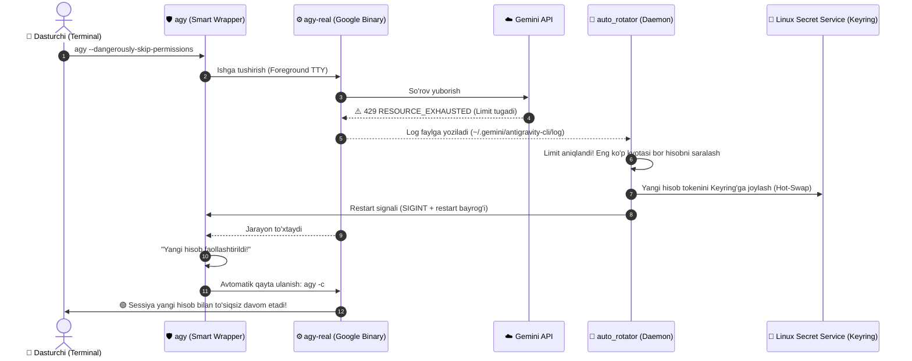

# 🚀 Google Antigravity (AGY) Multi-Account Quota Rotator

> **Avtomatik Gemini Pro Multi-Account boshqaruvchisi va Quota Rotator.**  
> Google Antigravity (AGY) CLI / IDE uchun bir nechta Google hisoblarini (Google One AI Premium / Gemini Pro) uzluksiz boshqarish, 5-soatlik va haftalik kvota tugaganda **100% avtomatik tarzda** keyingi hisobga o'tish va sessiyani avtomatik davom ettirish (`agy -c`) tizimi.

[](LICENSE)
[](#)
[](#)
[](#)

---

## 📌 Muammo nimada edi?

Google Antigravity CLI dasturida Gemini Pro yoki Claude modellaridan faol foydalanilganda 2 xil limit mavjud:
1. **5-soatlik limit** (Five Hour Limit) — qisqa vaqt ichida ko'p so'rov yuborilganda tugaydi.
2. **Haftalik limit** (Weekly Limit) — individual haftalik kvota.

Limit tugaganida API `RESOURCE_EXHAUSTED (code 429): Individual quota reached` xatosini qaytaradi. Foydalanuvchi rivojlantirish jarayonidan to'xtab, hisobni qo'lda almashtirishi yoki bir necha soat kutishiga to'g'ri kelar edi.

Bundan tashqari:
- `agy` dasturi ishga tushganda tokenni operativ xotiraga (**RAM**) yuklab oladi.
- Keyring'da hisob almashsa ham, ochiq turgan sessiya eski tokenni ishlataveradi.

---

## 💡 Biz yaratgan yechim (Arxitektura)

Ushbu loyiha muammoni 3 bosqichli to'liq avtomatlashgan arxitektura bilan hal qiladi:



---

## ✨ Asosiy Imkoniyatlar

- **🔄 100% Avtomatik Rotatsiya:** Limit tugaganda klaviaturaga teginishingiz shart emas. Tizim eng to'liq hisobga o'tib, avtomatik `agy -c` bilan davom ettiradi.
- **⚡ Hot-Swap (Linux Secret Service):** Tizim kalitlar ombori (`secretstorage`) orqali brauzersiz, 0.1 soniyada hisob almashtiriladi.
- **📊 Markazlashgan Kvota Jadvali:** Barcha 5 ta hisobning haftalik va 5-soatlik kvotasini bitta chiroyli jadvalda real vaqtda ko'rish (`switch-acc usage`).
- **🛡️ Smart TTY Wrapper:** Terminalning barcha ranglari, interaktiv menyulari, strelkalar va maxsus tugmalarini to'liq saqlab qoladi.
- **🔁 OAuth Token Auto-Refresh:** Har bir hisobning Google OAuth tokeni muddati tugasa, `refresh_token` orqali fonda avtomatik yangilanadi (qayta login qilish shart emas).
- **⚙️ Systemd Daemon:** Kompyuter yoqilishi bilan orqa fonda xizmat sifatida ishlaydi (`gemini-auto-rotator.service`).

---

## 📊 Markazlashgan Kvota Monitoringi

Istalgan vaqtda barcha hisoblaringizning holatini quyidagi buyruq bilan ko'rishingiz mumkin:

```bash
switch-acc usage
```

**Natija:**
```text
========================================================================================
🤖 GEMINI PRO MULTI-ACCOUNT KVOTA VA LIMITLAR HOLATI
========================================================================================
 # | Hisob (Google Account)       | Haftalik (Weekly) | 5-Soatlik Limit  | Holati
----------------------------------------------------------------------------------------
 👉 | bxaivideos@gmail.com         | [█████░░░░░]  53% | [██████████] 100% | 🟢 FAOL (Ishlatilmoqda)
 2 | eldorbekhusanov207@gmail.com | [░░░░░░░░░░]   0% | [█████████░]  88% | ⚠️ Haftalik limit tugagan
 3 | husansaidazamov34@gmail.com  | [████████░░]  83% | [██████████]  97% | ✅ Foydalanishga tayyor
 4 | saidkarimcyber01@gmail.com   | [█████░░░░░]  53% | [██████████] 100% | ✅ Foydalanishga tayyor
 5 | shakarovlaziz243@gmail.com   | [████████░░]  83% | [██████████] 100% | ✅ Foydalanishga tayyor
========================================================================================
💡 Mavjud tayyor hisoblar: 4/5 ta  |  Ma'lumot yangiligi: Hozir yangilandi
🔄 Jonli yangilash: switch-acc usage -r  |  Almashtirish: switch-acc <raqam>
========================================================================================
```

---

## 🛠️ O'rnatish va Sozlash

### 1. Reponi klonlash
```bash
git clone https://github.com/Lazizdeveloper/antigravity-multi-account-rotator.git
cd antigravity-multi-account-rotator
```

### 2. O'rnatish skriptini ishga tushirish
```bash
chmod +x install.sh
./install.sh
```

Ushbu buyruq:
1. `~/.gemini/accounts` katalogini yaratadi.
2. `switch-acc` CLI buyrug'ini `~/.local/bin` ga o'rnatadi.
3. `agy` binar faylini `agy-real` ga zaxiralab, o'rniga aqlli qobiqni (wrapper) joylaydi.
4. `gemini-auto-rotator.service` ni tizim xizmati sifatida ishga tushiradi.

---

### 3. Google hisoblarni qo'shish

Har bir hisob uchun token fayli `~/.gemini/accounts/<email>.json` formatida saqlanadi:

```bash
~/.gemini/accounts/
├── hisob1@gmail.com.json
├── hisob2@gmail.com.json
├── hisob3@gmail.com.json
├── hisob4@gmail.com.json
└── hisob5@gmail.com.json
```

**Token fayli namunasi (`accounts.example.json`):**
```json
{
  "token": {
    "access_token": "ya29.a0AfH6SM...",
    "token_type": "Bearer",
    "refresh_token": "1//04...",
    "expiry": "2026-09-30T12:00:00.000000Z"
  },
  "id_token": "eyJhbGciOiJSUzI1NiIs..."
}
```

> **💡 Eslatma:** Birinchi marta oddiy `agy` orqali login qilinganda, dastur tokenni tizim Keyring'iga yozadi. Siz shunchaki uni quyidagi buyruq bilan saqlab olasiz:
> ```bash
> python3 -c '
> import secretstorage, json
> bus = secretstorage.dbus_init()
> col = secretstorage.get_default_collection(bus)
> item = list(col.search_items({"service": "gemini", "username": "antigravity"}))[0]
> with open("~/.gemini/accounts/MENING_EMAILIM@gmail.com.json", "w") as f:
>     f.write(item.get_secret().decode("utf-8"))
> '
> ```

---

## ⌨️ CLI Buyruqlar Qo'llanmasi

| Buyruq | Vazifasi |
|---|---|
| `switch-acc usage` | Barcha hisoblar kvotasini ko'rish (keshdan tezkor) |
| `switch-acc usage -r` | Barcha hisoblar kvotasini jonli yangilab ko'rish |
| `switch-acc next` | Kvotasi eng ko'p keyingi hisobga o'tish (Smart Pick) |
| `switch-acc <raqam>` | Aniq hisob raqamini faollashtirish (masalan: `switch-acc 3`) |
| `switch-acc <email>` | Email orqali faollashtirish (masalan: `switch-acc husan`) |

---

## 📂 Fayllar Strukturasi

```
antigravity-multi-account-rotator/
├── bin/
│   ├── switch-acc          # Asosiy CLI vositasi
│   └── agy-wrapper         # Smart TTY wrapper (avtomatik agy -c)
├── src/
│   ├── account_manager.py  # Keyring boshqaruvi, token refresh, kvota audit
│   └── auto_rotator.py     # Loglarni kuzatuvchi daemon
├── systemd/
│   └── gemini-auto-rotator.service # Systemd user service
├── accounts.example.json   # Token fayli shabloni
├── install.sh              # Avtomatlashtirilgan o'rnatuvchi
├── LICENSE                 # MIT litsenziyasi
└── README.md               # Ushbu qo'llanma
```

---

## 🔒 Xavfsizlik

- Haqiqiy tokenlar, `client_secret` lar yoki shaxsiy ma'lumotlar ushbu repoda saqlanmaydi (`.gitignore` himoyasi).
- Barcha hisob ma'lumotlari faqat sizning mahalliy kompyuteringizdagi `~/.gemini/accounts/` katalogida va Linux xavfsiz kalitlar omborida (Keyring) shifrlangan holda saqlanadi.

---

## 👨‍💻 Muallif

**Laziz Shakarov** ([@Lazizdeveloper](https://github.com/Lazizdeveloper))  
NixOS & Linux muhitida Google Antigravity unumdorligini 5x baravarga oshirish uchun ishlab chiqildi.

---

## 📜 Litsenziya

MIT License. Foydalaning, ulashing va rivojlantiring!
